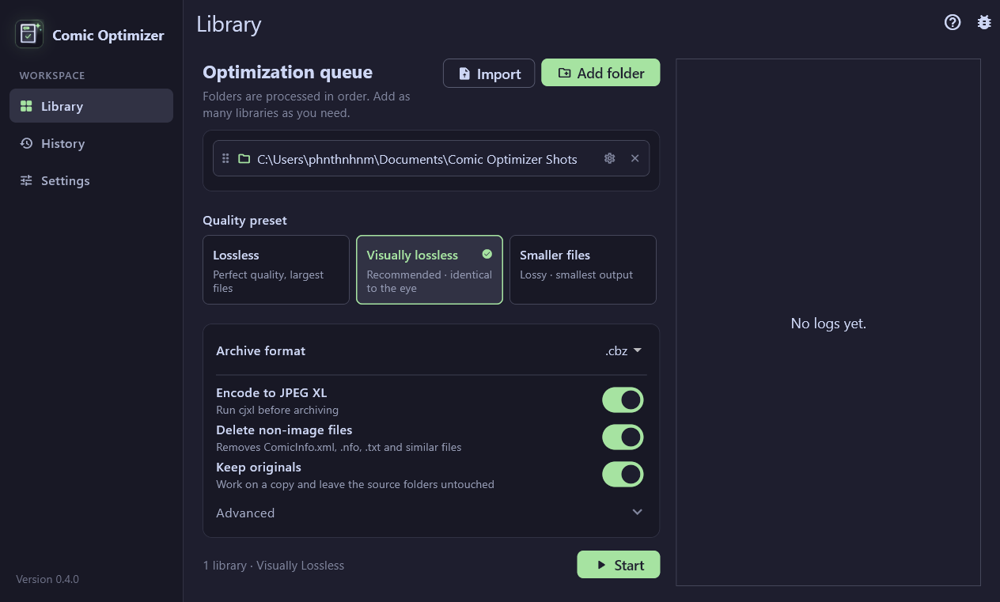
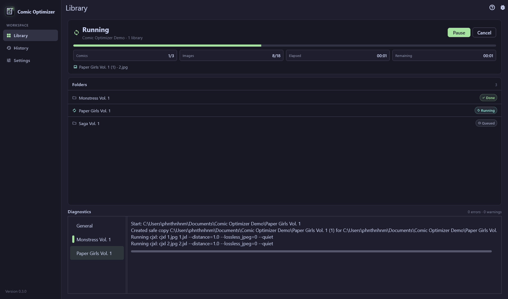
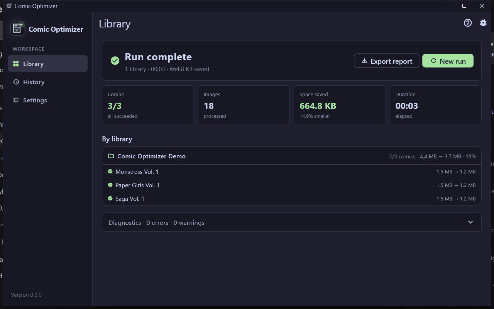
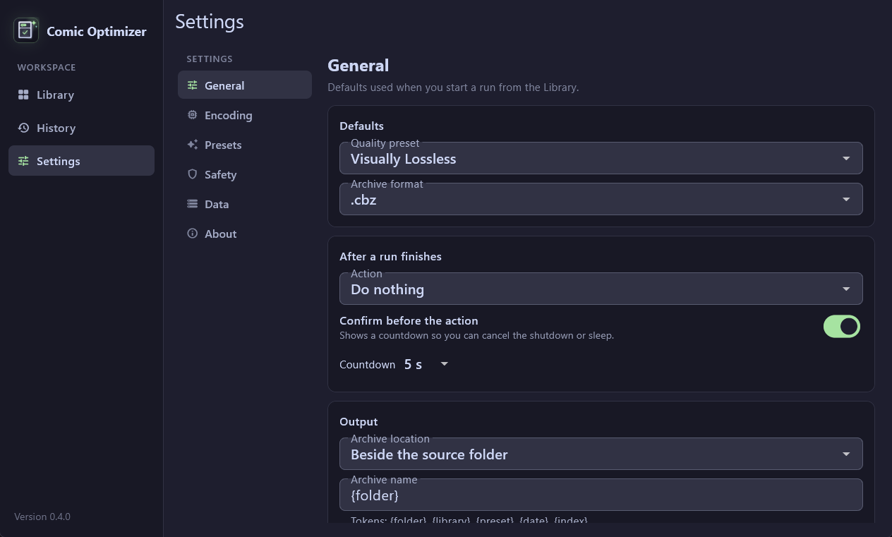

# Comic Optimizer

[](https://github.com/phnthnhnm/comic_optimizer/actions/workflows/ci.yml)

A Windows app that turns folders of comic pages into `.cbz` archives,
re-encoding each page to JPEG XL.









> [!WARNING]
> The app **modifies and deletes files**. With **Keep originals** off, it
> removes non-image files by default and deletes each source folder once its
> archive is written. Try **Keep originals** on a small folder first.

## Features

- Ordered library queue with preflight estimates, live progress, pause/resume, cancel, results and history.
- Lossless, Visually Lossless and Lossy presets, plus saved custom `cjxl` arguments.
- Staged, verified archives: the source stays untouched until the archive is published.
- Per-library preset/output overrides, custom output folders, naming templates and collision policies.
- Skip up-to-date archives and resume interrupted queues from a run journal.
- Bounded parallel encoding, sleep prevention, size guard and encoder fallbacks.
- Import `.cbz`/`.zip` archives into the same pipeline without touching the originals.
- First-run tutorial, keyboard shortcuts, taskbar progress, drag-and-drop folders and completion notifications.
- Starts maximized; animations are a simple fade and can be disabled in Settings → General.

## Requirements

- Windows 10 or later (x64).
- [`cjxl`](https://github.com/libjxl/libjxl) v0.11+ on `PATH` (tested with v0.13.0).
- Optional: ImageMagick (`magick`) for JPEG retries and `dwebp` for WebP pages.
- Building: Flutter 3.47+ / Dart 3.13+.

## Install

Download the latest `comic_optimizer-<version>-windows-x64.zip` from
[Releases](https://github.com/phnthnhnm/comic_optimizer/releases), extract it and
run `comic_optimizer.exe`. `cjxl` is not bundled; set its path in
**Settings → Encoding** if it is not on `PATH`.

To build from source:

```bash
git clone https://github.com/phnthnhnm/comic_optimizer.git
cd comic_optimizer
flutter pub get
flutter build windows --release
```

The build is in `build\windows\x64\runner\Release\`. Nightly artifacts are
available from the latest successful [CI run](https://github.com/phnthnhnm/comic_optimizer/actions/workflows/ci.yml).

## Usage

1. Add or drag in library folders, or use **Import** to optimize existing
   `.cbz`/`.zip` archives.
2. Pick a preset and options. Use the gear on a queue entry for per-library
   overrides. **Keep originals** is the safe choice for a first run.
3. Click **Start**, review the preflight and its size estimate, then confirm.
4. Review savings, reveal archives, and retry failures in **Results**, or
   revisit past runs in **History**.

A comic is a folder directly under a library root, or directly under one of
those folders. A root containing only images is treated as one comic.

### Keyboard shortcuts

| Shortcut | Action |
| --- | --- |
| `Ctrl+O` | Add a library folder |
| `Ctrl+Enter` | Start a run |
| `Ctrl+P` | Pause or resume |
| `Ctrl+E` | Export the finished run |
| `Ctrl+1` / `Ctrl+2` / `Ctrl+,` | Library / History / Settings |

## How it works

1. Scan the comic and record image sizes.
2. Encode pages into a temporary staging folder; WebP is converted with
   `dwebp`, failed JPEGs are retried through ImageMagick, and a larger `.jxl`
   is discarded.
3. Normalize pages to `001`, `002`, … and build the archive.
4. Verify every archive entry, atomically publish it, and only then delete the
   source folder (if **Keep originals** is off).

Archives are written beside the source by default, or to a configured output
folder with a naming template. Only files directly inside a comic folder are
archived; an existing archive is replaced only after the new one verifies.

## Presets

| Preset | `cjxl` arguments | Notes |
| --- | --- | --- |
| Lossless | `--distance=0 --lossless_jpeg=1 --quiet` | Mathematically lossless |
| Visually Lossless | `--distance=1.0 --lossless_jpeg=0 --quiet` | Recommended |
| Lossy | `--distance=3.0 --lossless_jpeg=0 --quiet` | Smallest files |

Custom presets are saved with the app's settings and appear beside the
built-ins.

## Settings and data

Settings live at
`%APPDATA%\com.phanthanhnam\comic_optimizer\shared_preferences.json`.
General covers output location, naming, collision behavior, skip-existing,
parallel encoders, sleep prevention and motion. Other sections cover the
encoder path, presets, safety, timestamped JSON backup/restore and About. The
theme is fixed to Catppuccin Mocha with a green accent.

## Development

```bash
flutter pub get
flutter analyze
dart format lib/ test/
flutter test
flutter build windows --release
```

Codegen after changing a freezed model or serialized enum:

```bash
dart run build_runner build --delete-conflicting-outputs
```

The suite has 159 tests; encoder integration tests use the real `cjxl` when it
is installed and skip otherwise.

## Troubleshooting

| Symptom | Fix |
| --- | --- |
| `cjxl` not found | Install libjxl or set the full path in Settings → Encoding |
| WebP pages fail | Install `dwebp` from libwebp |
| Source folder remains | Keep originals is on, or check the log for a write or lock error |
| Import produced no archive | Check the log and that the archive contains supported images |

## Contributing

Use Conventional Commits and run `flutter analyze` and `flutter test` before
pushing. Commits are signed.

## Releases

Releases are automated with
[release-please](https://github.com/googleapis/release-please): merging the
release PR publishes a GitHub release and attaches the Windows zip.

## License

See [LICENSE](LICENSE).
